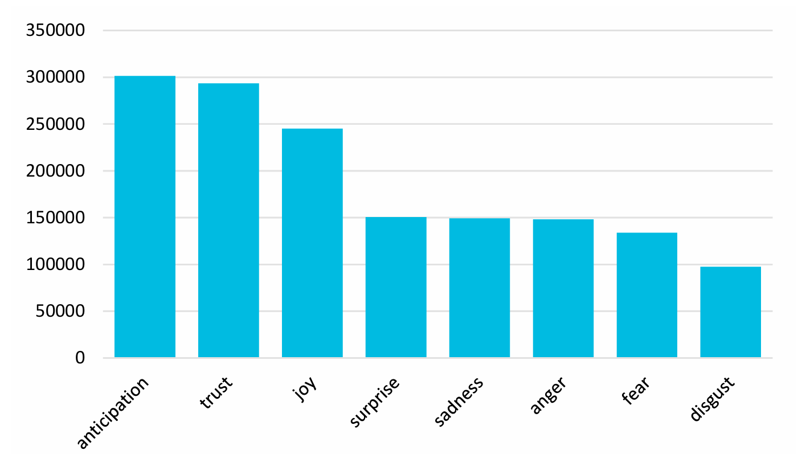

# Analiza sentymentu recenzji produktów na Amazonie

## Opis projektu

Projekt obejmuje analizę sentymentu recenzji produktów AGD opublikowanych na platformie Amazon. Celem było zbadanie zgodności między emocjonalnym wydźwiękiem opinii a ocenami gwiazdkowymi klientów oraz identyfikacja najczęściej wyrażanych emocji.

Analiza koncentruje się również na rozbieżnościach między sentymentem a ocenami liczbowymi, wynikających m.in. ze złożoności wypowiedzi, ich długości oraz odniesień do wcześniejszych doświadczeń klientów.

Projekt został zrealizowany w ramach pracy dyplomowej na studiach podyplomowych *Big Data – Analytics*.

## Dane i narzędzia

- **Źródło danych:** Amazon Reviews 2023 - Appliances
- **Zakres:** 582 119 recenzji dotyczących 25 572 produktów AGD
- **Python (NLTK, TextBlob, NRCLex)** - analiza sentymentu i identyfikacja emocji w recenzjach.
- **SQLite** - przechowywanie i przetwarzanie danych.

## Metody analizy

Do klasyfikacji recenzji wykorzystano VADER, narzędzie oparte na słowniku sentymentu, umożliwiające określenie pozytywnego, neutralnego lub negatywnego wydźwięku tekstu.

Wyniki analizy sentymentu porównano z ocenami gwiazdkowymi klientów, przyjmując następujący podział:
- **pozytywne:** 4–5 gwiazdek,
- **neutralne:** 3 gwiazdki,
- **negatywne:** 1–2 gwiazdki.

Do identyfikacji emocji występujących w recenzjach wykorzystano bibliotekę NRCLex, pozwalającą wyróżnić osiem kategorii emocjonalnych.

## Wyniki analizy

### 1. Zgodność sentymentu z ocenami gwiazdkowymi

Analiza wykazała przewagę pozytywnych recenzji produktów AGD. Ponad 76% opinii zostało zaklasyfikowanych jako pozytywne pod względem sentymentu.

W celu zbadania zgodności między sentymentem wyznaczonym na podstawie treści recenzji a ocenami gwiazdkowymi klientów przygotowano tabelę kontyngencji. Przedstawia ona procentowy udział poszczególnych kombinacji sentymentu i oceny gwiazdkowej w całym zbiorze recenzji.

| Ocena gwiazdkowa | Pozytywny sentyment | Neutralny sentyment | Negatywny sentyment | Łącznie |
|---|---:|---:|---:|---:|
| **Pozytywna** | 67,44% | 4,95% | 4,02% | 76,41% |
| **Neutralna** | 3,14% | 0,50% | 1,68% | 5,32% |
| **Negatywna** | 5,79% | 1,64% | 10,85% | 18,28% |
| **Łącznie** | 76,37% | 7,08% | 16,55% | 100% |

Największą zgodność zaobserwowano w przypadku pozytywnych opinii – 67,44% wszystkich recenzji miało zarówno pozytywną ocenę gwiazdkową, jak i pozytywny sentyment.

Nie zawsze jednak sentyment wynikający z treści recenzji był zgodny z oceną gwiazdkową wystawioną przez klienta. Przykładowo niektóre opinie z niską oceną gwiazdkową zostały zaklasyfikowane jako neutralne lub pozytywne pod względem sentymentu.

### 2. Przyczyny rozbieżności w klasyfikacji sentymentu

Niektóre recenzje, mimo negatywnej oceny gwiazdkowej, mają neutralny i rzeczowy charakter. Klienci opisują problemy z produktem bez używania wyraźnie negatywnych sformułowań, przez co narzędzia analizy sentymentu mogą zaklasyfikować takie opinie jako neutralne. Pokazuje to ograniczenia automatycznej analizy tekstu, która nie zawsze prawidłowo interpretuje kontekst wypowiedzi.

Dodatkowym wyzwaniem są dłuższe i bardziej złożone recenzje, w których autorzy poruszają wiele wątków lub odnoszą się do wcześniejszych doświadczeń z innymi produktami. Algorytm nie zawsze potrafi rozróżnić, czy wyrażone emocje dotyczą aktualnie ocenianego produktu, czy wcześniejszych zakupów, co również może prowadzić do rozbieżności między sentymentem a oceną gwiazdkową.

### 3. Najczęściej występujące słowa

W analizowanych recenzjach często pojawiały się słowa o pozytywnym wydźwięku, szczególnie:

- **„great” – 130 142 wystąpienia**,
- **„good” – 79 246 wystąpień**.

Ich wysoka częstotliwość jest spójna z przewagą pozytywnych opinii w analizowanym zbiorze danych.

### 4. Rozkład emocji w recenzjach

Analiza z wykorzystaniem biblioteki NRCLex wykazała, że najczęściej identyfikowanymi emocjami były:

- **oczekiwanie (anticipation)** – 301 376 recenzji,
- **zaufanie (trust)** – 293 476 recenzji,
- **radość (joy)** – 245 181 recenzji.

Emocje negatywne, takie jak złość, smutek, strach czy wstręt, występowały rzadziej.

*Rozkład emocji zidentyfikowanych w recenzjach produktów AGD. Jedna recenzja mogła zostać przypisana do więcej niż jednej kategorii emocji.*

## Wnioski

Analiza sentymentu wskazuje na ogólną przewagę pozytywnych opinii o produktach AGD. Wyniki klasyfikacji tekstu są w dużej mierze zgodne z ocenami gwiazdkowymi, co potwierdza zarówno wysoki udział pozytywnych recenzji, jak i częste występowanie słów o pozytywnym wydźwięku.

Jednocześnie zaobserwowano rozbieżności między ocenami liczbowymi a sentymentem, szczególnie w przypadku opinii neutralnych i negatywnych. Mogą one wynikać z trudności automatycznych narzędzi w interpretacji kontekstu, zwłaszcza gdy recenzje zawierają wiele wątków lub odniesienia do wcześniejszych doświadczeń klientów.

Analiza emocji wykazała, że najczęściej identyfikowano oczekiwanie, zaufanie i radość, natomiast emocje negatywne występowały rzadziej.

Wyniki pokazują, że automatyczna analiza sentymentu może być przydatnym narzędziem do badania opinii konsumentów, jednak jej interpretacja wymaga uwzględnienia ograniczeń związanych ze złożonością języka i kontekstem wypowiedzi.
